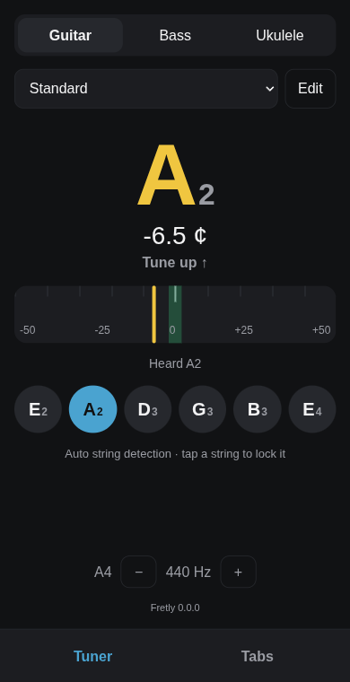
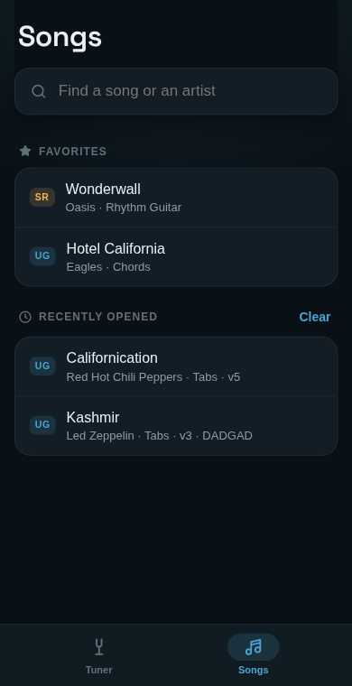
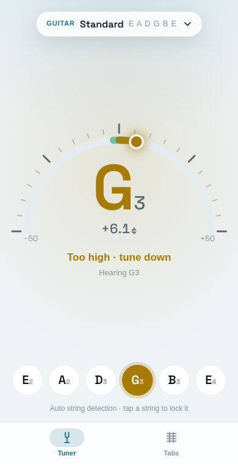

# Fretly

A guitarist's toolbox for guitar, bass and ukulele: a precise tuner, an offline song library with free tabs from Ultimate Guitar and Songsterr, chord and scale dictionaries, a metronome, and a transcriber that turns a recording into chords and notes. Built for my own iPhone because I got tired of paying for both.

<p align="center">
  
  
  
</p>

> **Vibe-coded.** This app was built through conversation with an AI coding assistant, then tested on a real guitar and a real iPhone. The pitch detection is covered by precision tests, the rest by use.

## Features

**Tuner**
- Sub-cent accuracy: McLeod pitch detection, checked by tests at ±0.5 cent from a 5-string bass low B (31 Hz) to ukulele high G
- Arc meter readable from a distance: the whole screen tints green when the string is in tune
- Automatic string detection, or tap a string to lock it; strings get ticked as you tune them
- Reference note: lock a string and tap "Hear" to play it (plucked-string sound at the exact pitch, A4 setting included)
- Guitar (Standard, Drop D, DADGAD, Open G/D/E, ½ step down, D Standard, Drop C, guitalele), bass (4 and 5 strings, Drop D), ukulele (high G, low G, baritone)
- Custom tunings and A4 calibration (430–450 Hz), in a sheet that stays out of the way
- Raw microphone input (no echo cancellation, noise suppression or auto gain), reading steadied by a median and an exponential moving average

**Songs**
- Your library first: favorites (most recently played on top, or A–Z) and recently opened tabs, with capo and tuning on each line
- Favorites are saved in full: they open offline, keep their transposition, and survive a tab being removed upstream
- Typing in the search field filters your library instantly, offline; the online search across Ultimate Guitar and Songsterr comes below, grouped by song, with the versions you saved starred and on top
- Ultimate Guitar versions ranked by a vote-weighted rating, so a 5★ tab with 3 votes does not beat a 4.8★ one with 2,500
- Tabs fit the phone at any text size: lyrics wrap with their chords (which stay above the right syllable), tab staffs are cut after a bar line or between beats, all strings together
- "Tune to DADGAD": when a tab needs another tuning, one tap sets the tuner, and the Songs tab brings you back to the song
- Transposition, remembered text size, auto-scroll with speed control in a thumb-reach toolbar

**Tools**
- Chord dictionary: 12 roots × 18 chord types, shapes computed for your tuning (DADGAD, ukulele, guitalele…), swipe through them, strum to hear
- Tap a chord name in any tab to see its shapes
- Scales on a vertical neck in your tuning (bass included): major, minor, pentatonics, blues, modes; notes or intervals, play to hear
- Metronome: 30–240 BPM, tap tempo, 2/4 to 6/4 with an accented first beat, clicks scheduled on the audio clock

**Transcribe**
- Record your guitar (or a song playing nearby) or import an audio file, and get its chords over time, the key, every note in order, and a suggested tab in your tuning
- Notes come from [Basic Pitch](https://github.com/spotify/basic-pitch) (Spotify, Apache-2.0), running on the phone, offline; the app then cleans the model's doubles, overtones and re-triggered strings before naming chords
- Play the original back with the current chord highlighted; tap any chord for its shapes
- Best on one instrument; full mixes with drums and vocals give rougher results

**App**
- The screen stays on while the tuner listens, a tab is open or the metronome runs
- Updates itself: every push to `main` is published as an encrypted, signed web bundle; the app installs it only if the signature matches the public key it ships with
- Light and dark themes, iPhone safe areas, reduced-motion support

## Install on iPhone (no Mac, no paid developer account)

1. Download `fretly.ipa` from the [`ipa` release](https://github.com/Kirato77/fretly/releases/tag/ipa).
2. Install it with a sideloading tool that signs apps with your own Apple ID, e.g. [SideStore](https://sidestore.io) or [LiveContainer](https://github.com/LiveContainer/LiveContainer) (set up with [iloader](https://github.com/nab138/iloader) from Linux, Windows or macOS).
3. Open Fretly, tap the microphone in the middle of the dial and allow the microphone.

After that, new versions arrive on their own ("New version ready" → Refresh applies it in place, or it applies the next time you leave the app). A new IPA is only needed when native code changes.

## Development

```sh
npm install
npm run dev        # http://localhost:5173 (the dev server relays tab requests: the sites send no CORS headers)
npm run dev:lan    # HTTPS on your network, to try the tuner in iPhone Safari before building
npm test           # precision tests on synthetic tones, parsers on invented page shapes, wrapping, library, signing
npm run build
```

Tested with Node 24.

### How it is built

| Path | What |
|---|---|
| `src/tuner/` | Pitch detection (`pitchy`), smoothing, tunings, dial and tuning sheet |
| `src/tabs/` | Ultimate Guitar and Songsterr clients and parsers, chord-sheet wrapping, library (favorites, recently opened), Songs tab, tab viewer |
| `src/updater.ts` | Self-hosted live updates through [`@capgo/capacitor-updater`](https://github.com/Cap-go/capacitor-updater), no telemetry |
| `scripts/sign-bundle.ts` | Encrypts the web bundle and signs its SHA-256 (same scheme as Capgo's CLI, Node standard library only) |
| `src/tools/` | Music theory (chords, voicing search, scales), chord diagrams, neck, metronome |
| `src/transcribe/` | Audio to notes (Basic Pitch, loaded on demand), note cleanup, chord timeline, key, string placement |
| `public/models/basic-pitch/` | The Basic Pitch model and its license, served with the app for offline use |
| `ios/` | Capacitor iOS shell |
| `.github/workflows/web.yml` | On push: test, build, sign, publish the web bundle as a release |
| `.github/workflows/ios.yml` | On demand: build the unsigned IPA on a macOS runner |

Stack: [SolidJS](https://www.solidjs.com), [Vite](https://vite.dev), [Capacitor](https://capacitorjs.com), TypeScript, Vitest.

### Updates in a fork

Bundles are signed with a private key kept as the `BUNDLE_PRIVATE_KEY` repository secret; the matching public key is in `capacitor.config.ts`. A fork needs its own pair:

```sh
node -e 'const k=require("crypto").generateKeyPairSync("rsa",{modulusLength:2048,publicKeyEncoding:{type:"pkcs1",format:"pem"},privateKeyEncoding:{type:"pkcs1",format:"pem"}});require("fs").writeFileSync("bundle-private.pem",k.privateKey,{mode:0o600});console.log(k.publicKey)'
gh secret set BUNDLE_PRIVATE_KEY < bundle-private.pem
```

Paste the printed public key into `capacitor.config.ts`, point `LATEST` in `src/updater.ts` at your repository, and build a new IPA.

## Disclaimer

Fretly is a personal project, not affiliated with Ultimate Guitar or Songsterr. It reads their public pages and endpoints, which are unofficial, may change at any time, and are subject to their terms of service. Tabs belong to their authors and rights holders; Fretly does not host or redistribute any. Use it for personal practice.

## License

[MIT](LICENSE)
